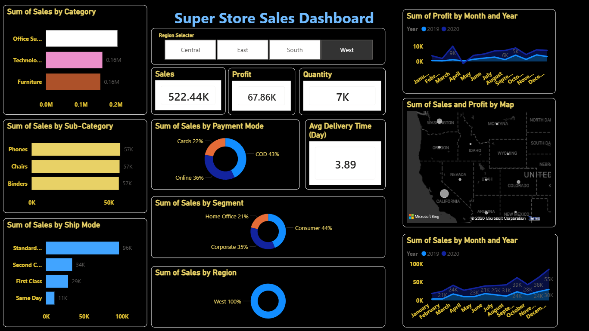

# Super Store Sales Dashboard & Forecasting

An end-to-end sales performance and predictive analytics solution developed using **Power BI** and **Microsoft Excel**. This project provides interactive visibility into supermarket operations, financial health, logistics performance, and future sales trajectories through historical time-series forecasting.

---

## 📌 Dashboard Preview


---

## 📊 Business Overview & Key Metrics (KPIs)
* **Total Sales:** $1.57M
* **Total Profit:** $175.26K
* **Total Quantity Sold:** 22K units
* **Profit Margin:** ~11.16%
* **Order Fulfillment:** Comprehensive tracking of delivery cycles across diverse shipping tiers.

---

## 🛠 Key Features & Analysis
* **Executive KPI Cards:** Instant visibility into top-line sales, aggregate profit, and volume metrics.
* **Interactive Slicers & Dynamic Filtering:** Filter views by Region (East, West, Central, South), Customer Segment, and Date intervals.
* **Category & Sub-Category Diagnostics:** Margin and revenue evaluation across Technology, Furniture, and Office Supplies.
* **Customer Segment Breakdown:** Comparative analysis across Consumer, Corporate, and Home Office portfolios.
* **Logistics & Ship Mode Optimization:** Fulfillment patterns evaluated across Standard Class, Second Class, First Class, and Same Day shipping.
* **Payment Mode Share:** Revenue distribution across Cash on Delivery (COD), Cards, and Online transfers.
* **Time-Series Sales Forecasting:** Integrated statistical forecasting modeling seasonal variations, demand shifts, and upcoming sales trends.

---

## 📐 Core DAX Measures

### 1. Total Sales
```dax
Total Sales = SUM(SuperStore_Sales_Dataset[Sales])
```

### 2. Total Profit
```dax
Total Profit = SUM(SuperStore_Sales_Dataset[Profit])
```

### 3. Total Quantity Sold
```dax
Total Quantity = SUM(SuperStore_Sales_Dataset[Quantity])
```

### 4. Profit Margin (%)
```dax
Profit Margin = 
DIVIDE(
    [Total Profit], 
    [Total Sales], 
    0
)
```

### 5. Total Orders
```dax
Total Orders = DISTINCTCOUNT(SuperStore_Sales_Dataset[Order ID])
```

### 6. Average Delivery Days
```dax
Avg Delivery Days = 
AVERAGEX(
    SuperStore_Sales_Dataset, 
    DATEDIFF(SuperStore_Sales_Dataset[Order Date], SuperStore_Sales_Dataset[Ship Date], DAY)
)
```

### 7. Year-to-Date (YTD) Sales
```dax
YTD Sales = 
TOTALYTD(
    [Total Sales], 
    'Calendar'[Date]
)
```

### 8. Prior Year Sales (YoY Analysis)
```dax
Sales Prior Year = 
CALCULATE(
    [Total Sales], 
    SAMEPERIODLASTYEAR('Calendar'[Date])
)
```

### 9. Year-over-Year Growth Rate (%)
```dax
YoY Sales Growth % = 
DIVIDE(
    [Total Sales] - [Sales Prior Year], 
    [Sales Prior Year], 
    0
)
```

---

## 📂 Repository Structure
```text
├── Dashboard.png                 # Exported screenshot of the completed Power BI dashboard
├── README.md                     # Comprehensive project documentation
├── SuperStore.pbix               # Main Power BI report file (Data Model, Visuals, DAX)
└── SuperStore_Sales_Dataset.csv  # Raw supermarket transactional records
```

---

## 🚀 Getting Started & Local Setup

### Prerequisites
* Windows OS
* [Power BI Desktop](https://powerbi.microsoft.com/desktop/) installed

### Running the Report
1. Clone this repository:
   ```bash
   git clone [https://github.com/Kushagramishra458/Super-Store-Sales-Dashboard-and-Forecasting.git](https://github.com/Kushagramishra458/Super-Store-Sales-Dashboard-and-Forecasting.git)
   ```
2. Navigate into the cloned directory:
   ```bash
   cd Super-Store-Sales-Dashboard-and-Forecasting
   ```
3. Open `SuperStore.pbix` in **Power BI Desktop**.
4. If prompted to fix the data path:
   * Navigate to **Home > Transform Data > Data Source Settings**.
   * Click **Change Source** and browse to the local path of `SuperStore_Sales_Dataset.csv`.
   * Click **Close & Apply**.
